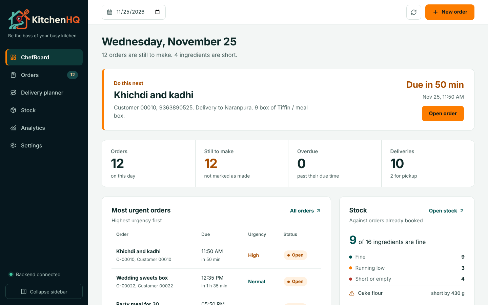
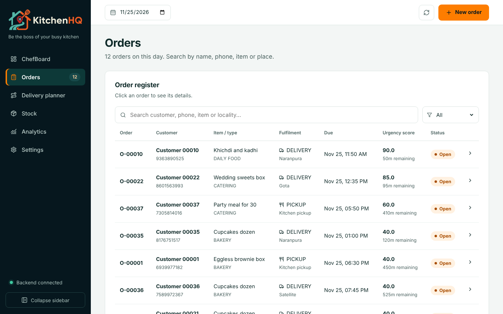
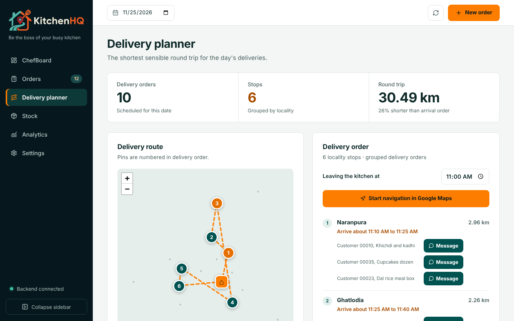
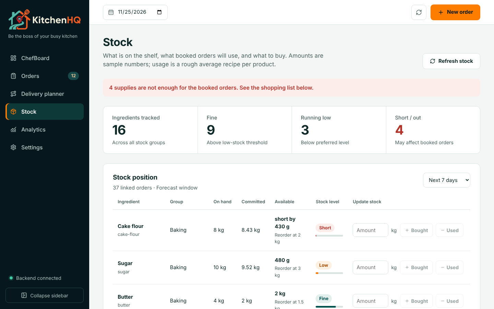
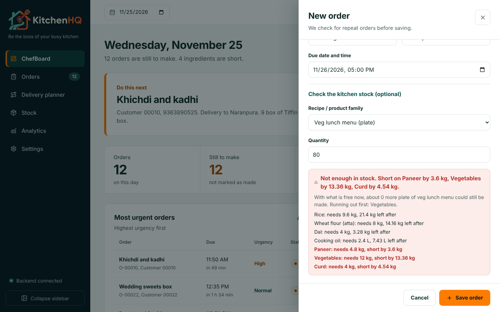
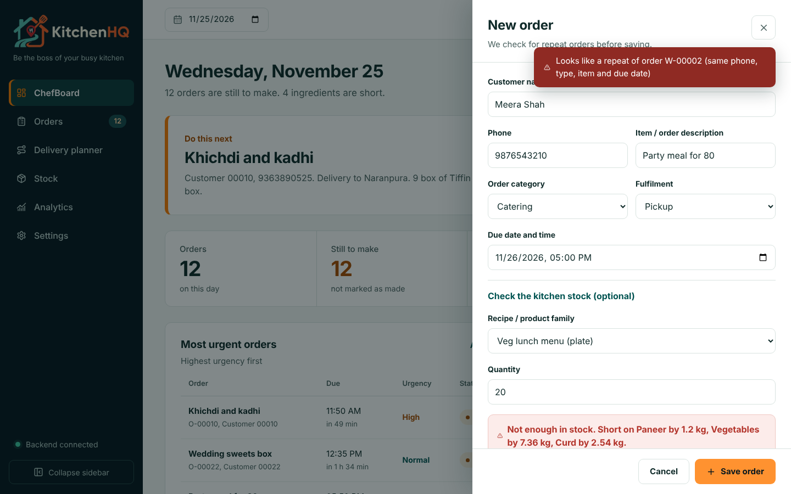

# KitchenHQ

*Be the boss of your busy kitchen.*

KitchenHQ is a planning tool for a home food business, Homemade Delicacies, in South Bopal, Ahmedabad. Its daily screen is called ChefBoard. It was built for the CIA 3 Real-World Application Project of Advanced Algorithm (B.Tech CS AI & ML, Semester V, ATLAS uGDX School of Technology, faculty Prof. Nimesh Bumb).

The Java packages are still named `com.rasoiroute`, which was the project's first name.

## What it does

- Checks every new order against earlier ones and refuses repeats.
- Ranks the day's orders by urgency and shows what to cook next.
- Plans a short delivery round trip, with an arrival window for each stop and a ready-made WhatsApp message for each customer.
- Tracks ingredients against booked orders, warns when something is low or short, and writes a shopping list in whole packs.
- Can make sample orders and pretend it is a different time of day, so it can be shown without real customers.

## Algorithms and where they are

| What | Technique | Code |
|---|---|---|
| Repeat order check | Bloom filter, confirmed by an exact set | `algo/BloomFilter.java`, `algo/DuplicateScreener.java` |
| Most urgent k orders | Randomized Quickselect, then sort the k | `algo/Quickselect.java`, `urgency/UrgencyRanker.java` |
| Minimum spanning tree | Prim with an indexed min-heap | `route/PrimMst.java`, `algo/IndexedMinHeap.java` |
| Delivery route | Metric TSP 2-approximation (tree walk) | `route/TourBuilder.java` |
| Best route on small days (yardstick) | Held-Karp, up to 17 stops | `route/ExactTsp.java` |
| Stock allocation | Greedy by urgency | `stock/Allocator.java` |

All paths are under `src/main/java/com/rasoiroute/`. The technical report explains each one, with pseudocode, correctness and complexity.

## Team

| Name | ID | Part |
|---|---|---|
| Arnav Jain | 2408014 | Problem finding, solution design, backend |
| Harshit Wadhwani | 2407800 | Frontend |
| Keval Kakadiya | 2408442 | Documentation |

## What you need

- JDK 17 or newer. We used 21. Check with `java -version`.
- Maven 3.8 or newer. Check with `mvn -version`.
- Node.js 18 or newer, only if you want to rebuild the frontend. The built page is already in `src/main/resources/web`.
- A web browser. Internet is needed only for the map background tiles.

## Build and run

```
git clone https://github.com/Jainyyyy/KitchenHQ.git
cd KitchenHQ
mvn clean test
mvn compile
java -cp target/classes com.rasoiroute.api.RasoiServer
```

Then open http://localhost:8080 in a browser. To use another port, add it at the end: `RasoiServer 9090`.

The server prints a line when it is ready. Stop it with Ctrl+C.

To see the app with data, open **Settings** and press **Load sample orders**.

### Rebuilding the frontend (optional)

```
cd frontend
npm install
npm run build
cd ..
mvn compile
```

The build writes into `src/main/resources/web`, which the Java server serves.

## Environment variables and secrets

None. There are no API keys, accounts or databases. The server listens on 127.0.0.1 only and keeps orders and stock in memory. Orders are lost when the server stops.

## API examples

The commands use `curl`. On Windows PowerShell write `curl.exe` instead of `curl`. Keep the quotes around addresses that contain `&`.

```
curl http://localhost:8080/api/health

curl -X POST "http://localhost:8080/api/demo/generate?count=40&days=3&dupRate=0.1&seed=42"

curl -X POST -H "Content-Type: application/json" -d @docs/samples/new-order.json http://localhost:8080/api/orders

curl "http://localhost:8080/api/plan?date=2026-12-01&k=3"

curl "http://localhost:8080/api/stock?date=2026-12-01&days=3"

curl -X POST -H "Content-Type: application/json" -d @docs/samples/check-stock.json http://localhost:8080/api/orders/check
```

Sending the same `new-order.json` twice gives status 409 the second time:

```
{"accepted":false,"message":"Looks like a repeat of order W-00001 (same phone, type, item and due date)","duplicateOfId":"W-00001"}
```

| Method | Path | Purpose |
|---|---|---|
| GET | `/api/health` | Server is up, number of orders |
| GET | `/api/localities` | Places we deliver to |
| GET | `/api/orders` | Orders for a day (`date`, `now`) |
| POST | `/api/orders` | Save an order, 409 for a repeat |
| POST | `/api/orders/check` | Can we make this quantity with current stock |
| POST | `/api/orders/made` | Mark an order made and use its ingredients |
| DELETE | `/api/orders` | Delete all orders |
| GET | `/api/plan` | Urgency ranking, route, stops, estimates (`date`, `now`, `k`) |
| GET | `/api/stock` | Stock levels and shopping list (`date`, `days`, `now`) |
| POST | `/api/stock/adjust` | Add or use stock |
| POST | `/api/stock/reset` | Go back to the sample stock |
| POST | `/api/demo/generate` | Make sample orders (`count`, `days`, `dupRate`, `seed`) |

Errors come back as `{"error": "..."}` with status 400 (bad input), 404, 405, 409 or 413.

## Test data

- `docs/samples/` has two request bodies that work with the examples above.
- The sample order generator (Settings, or `/api/demo/generate`) uses a fixed seed, so the same seed gives the same kind of day. Dates start from the day you run it.
- `src/main/resources/localities.csv` is the list of 16 Ahmedabad localities and the kitchen. The coordinates are approximate placeholders.
- `src/main/resources/stock/` has the sample ingredients, 7 product families and their recipes. The amounts are sample values.

## Tests and benchmarks

```
mvn clean test
```

runs 315 JUnit tests. To run the benchmarks (this takes a while), on Windows:

```
mvn test-compile
java -cp "target/classes;target/test-classes" com.rasoiroute.bench.Benchmarks > benchmark-results.md
```

On macOS or Linux use `:` instead of `;` in the class path. The numbers in `docs/benchmark-results.md` came from a 2-core machine, so yours will differ in time but should match in shape.

## Screenshots

| | |
|---|---|
|  |  |
| ChefBoard | Orders |
|  |  |
| Delivery planner | Stock |
|  |  |
| Stock check on a new order | Repeat order refused |

More are in `docs/screenshots/`. The map shows pins and the route but no street background when there is no internet.

## Known limits

- Locality coordinates and stock amounts are placeholders until the kitchen's real data is entered.
- Distances are straight-line, not road distances. Arrival times are estimates.
- The route is guaranteed to be at most twice the best route. It is not the best route.
- Data is in memory only. One user, no login.

## Folder layout

```
src/main/java/com/rasoiroute/   backend (algo, api, dispatch, geo, model, route, stock, urgency)
src/main/resources/             locality and stock CSV files, built frontend (web/)
src/test/java/com/rasoiroute/   tests and the benchmark program
frontend/                       React source (Vite)
docs/                           samples, screenshots, charts, benchmark results
pom.xml                         Maven build and dependency list (JUnit for tests)
```
